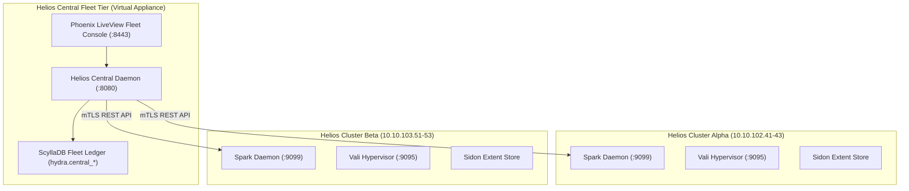
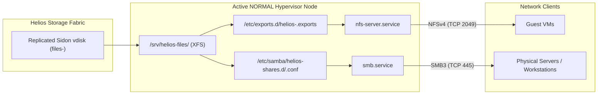
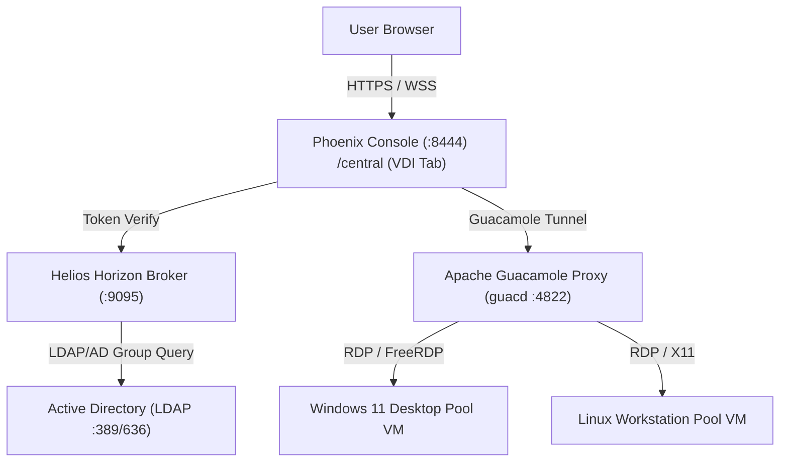
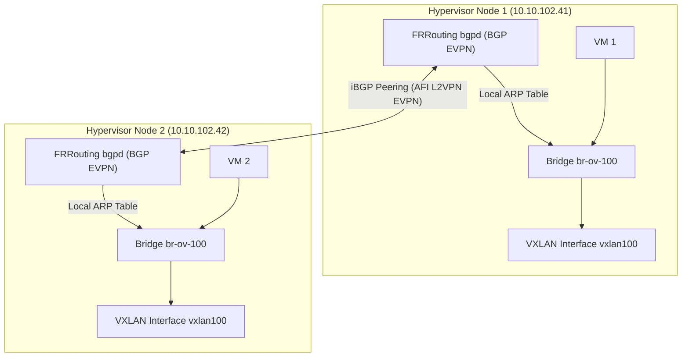
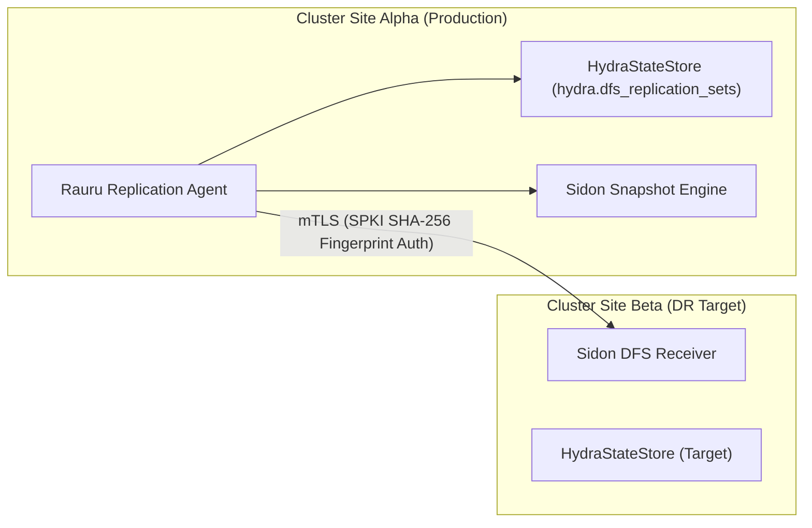

# Helios-HCI Scale-Out Add-ons & Fleet Services Reference Guide

This document specifies the architecture, data models, APIs, and operational workflows for the scale-out add-on systems integrated into Helios-HCI.

---

## 1. Helios Central (Multi-Cluster Fleet Federation)

Helios Central is the multi-cluster federation and fleet orchestration tier (analogous to VMware vCenter Server Appliance or Nutanix Prism Central). It manages multiple independent Helios-HCI clusters through an autonomous virtual management appliance.



### Architectural Details:
* **Auto-Deploy Virtual Appliance**: 1-click cloud-init NoCloud deployment pipeline with lean sizing presets:
  - `tiny`: 2 vCPUs, 4 GiB RAM, 32 GiB Sidon CoW disk.
  - `standard`: 4 vCPUs, 8 GiB RAM, 64 GiB disk.
  - `enterprise`: 8 vCPUs, 16 GiB RAM, 120 GiB disk.
* **ScyllaDB Fleet Ledger**:
  - `hydra.central_clusters` (migration `0055`): records enrolled clusters, VIPs, mTLS certificates, health status, and hardware allocations.
  - `hydra.central_config` (migration `0056`): global fleet preferences, LDAP federation, and alert sinks.
* **Zero-Mock Policy**: All 62 fleet views map directly to authentic tables and live hypervisor queries. Unconfigured subsystems report genuine empty states (`[]`) rather than placeholder numbers.
* **Hardware Deep Dives**:
  - **Cluster View (`view-cluster_detail`)**: Hypervisor vCPU allocation, memory reservation, local Sidon extent store slices, physical 10GbE NICs with MAC addresses, hosted VMs, and Mimir diagnostics.
  - **Host View (`view-host_detail`)**: Hypervisor vCPU allocation, memory reservation, local Sidon extent store slices, physical 10GbE NICs with MAC addresses, hosted VMs, and Mimir diagnostics.
  - **VM View (`view-vm_detail`)**: Live vCPU/vRAM topology, attached Sidon CoW vDisks (`storage_vdisks`), crash-consistent snapshot engine (`recovery_points`), live migration across hosts via Spark mTLS, hardware reset, and web console.
* **LCM Fleet Rolling Upgrades**: Orchestrated rolling upgrades across hypervisor daemons (`lcm_updates`, `POST /api/v1/lcm/upgrade`) with task tracking and audit logging.
* **CLI Management**:
  ```bash
  valcli central.status
  valcli central.deploy [--preset standard]
  valcli central.cluster.list
  valcli central.cluster.add <name> <vip> <cert_path>
  valcli central.cluster.remove <name>
  ```

---

## 2. Helios Files (Scale-Out File Server)

Helios Files (`helios_files.py`) provides scale-out, highly available NFSv4 and SMB3 file services backed directly by replicated Sidon virtual disks without running heavy third-party NAS storage appliances.



### Architectural Details:
* **Storage Backing**: Provisions or attaches a dedicated replicated Sidon vdisk (`files-<share>`), formats and mounts XFS at `/srv/helios-files/<share>`, and configures native Linux kernel NFS/Samba exports.
* **Automatic High Availability Failover**:
  - `mipha.py` (`failover_orphaned_file_shares`) monitors node liveness.
  - If the hosting hypervisor transitions to `DOWN` or `FENCED`, Mipha advances the Sidon vdisk epoch on a surviving `NORMAL` node, attaches the vdisk, mounts XFS, and issues `exportfs -ra` / `smbcontrol all reload-config`.
* **Database Schema**:
  - `hydra.files_shares` (migration `0058-helios-files-shares`): tracks `share_name`, `vdisk_id`, `size_gb`, `protocol` (`nfs`, `smb`, `both`), `allowed_ips`, `squash`, `active_host_ip`, `status`, and `created_at`.
* **API Endpoints**:
  - Spark REST: `GET /api/v1/host/files`, `POST /api/v1/host/files` (actions: `provision`, `attach_mount`, `unmount_detach`, `failover`).
  - Spectrum REST: `GET /api/files/shares`, `POST /api/files/create`, `POST /api/files/delete`, `POST /api/files/failover`.
* **CLI Management**:
  ```bash
  valcli files.share.list
  valcli files.share.create <name> --size-gb 500 --protocol both --allowed-ips "10.0.0.0/8"
  valcli files.share.delete <name>
  valcli files.share.failover <name> --target-host <ip>
  valcli files.status
  ```
* **Phoenix Console**: Managed directly within `Storage.IndexLive` (`/storage`).

---

## 3. Helios Horizon (Virtual Desktop Infrastructure)

Helios Horizon (`helios_horizon.py`) is an Active Directory-integrated Virtual Desktop Infrastructure (VDI) broker and application streaming gateway using Apache Guacamole (`guacd`).



### Architectural Details:
* **Pool Orchestration**:
  - **Dedicated (Persistent)**: Each user is permanently assigned a dedicated VM clone.
  - **Floating (Non-Persistent)**: Users receive a clean VM from the pool upon login, reset upon disconnect via Sidon linked clone rollback.
  - **Linked-Clone Provisioning**: Fast, zero-copy linked clones from master VM templates (`vdisk_id` CoW clone + `hydra.vms` registration).
* **Security & Authentication**:
  - Active Directory / LDAP entitlement validation (`check_user_pool_entitlement`).
  - Cryptographically signed HMAC-SHA256 Guacamole connection tokens (`build_guacd_connection_spec`, `sign_horizon_token`, `verify_horizon_token`).
* **Database Schema**:
  - `hydra.horizon_pools` (migration `0059-helios-horizon-vdi`): `pool_name`, `pool_type`, `template_vm`, `min_desktops`, `max_desktops`, `vcpu`, `memory_mb`, `protocol`, `port`, `entitled_groups`, `state`.
  - `hydra.horizon_sessions`: `session_id`, `pool_name`, `username`, `vm_name`, `host_ip`, `client_ip`, `protocol`, `state`, `connected_at`, `last_keepalive`.
* **API Endpoints**:
  - Spark REST: `GET /api/v1/host/horizon`, `POST /api/v1/host/horizon` (actions: `inspect_guacd`, `restart_guacd`, `check_port`).
  - Spectrum REST: `GET /api/horizon/pools`, `POST /api/horizon/pools/create`, `POST /api/horizon/pools/delete`, `POST /api/horizon/pools/provision`, `GET /api/horizon/sessions`, `POST /api/horizon/connect`, `POST /api/horizon/disconnect`.
* **CLI Management**:
  ```bash
  valcli vdi.pool.list
  valcli vdi.pool.create <name> --type floating --template win11-tmpl --min 5 --max 20 --entitled-groups "Domain Users,Engineering"
  valcli vdi.pool.delete <name>
  valcli vdi.pool.provision <name> --count 5
  valcli vdi.session.list
  valcli vdi.session.connect <pool> <user>
  valcli vdi.session.disconnect <session_id>
  valcli vdi.status
  ```
* **Phoenix Console**: Accessible via Central console at `/central` (tab `#tab-horizon`).

---

## 4. Scale-Out Urbosa (BGP L2VPN EVPN Control Plane)

Scale-Out Urbosa (`urbosa.py`) replaces static Head-End Replication (HER) packet flooding with an industry-standard BGP L2VPN EVPN control plane running over FRRouting (`frr` / `bgpd`).



### Architectural Details:
* **Control Plane Routing**:
  - Automatically generates `/etc/frr/frr.conf` with BGP ASN, router ID, BFD failure detection profiles, and EVPN address-family configuration (`address-family l2vpn evpn`, `advertise-all-vni`).
  - Re-reads and reloads FRR daemons safely without dropping established data-plane tunnels.
* **Kernel Bridge ARP Suppression**:
  - Dynamically configures overlay interfaces with `nolearning` and sets bridge port `neigh_suppress on`.
  - Bridges locally answer guest ARP queries from learned EVPN MAC/IP tables, eliminating broadcast storming across physical underlay fabrics.
* **Database Schema**:
  - `hydra.urbosa_bgp_config` (migration `0057-urbosa-bgp-evpn`): `cluster_id`, `local_asn`, `router_id`, `evpn_enabled`, `route_distinguisher_prefix`, `route_target_import`, `route_target_export`, `bfd_enabled`, `updated_at`.
  - `hydra.urbosa_bgp_peers`: `peer_ip`, `remote_asn`, `peer_group`, `description`, `state`, `created_at`.
* **API Endpoints**:
  - Spark REST: `GET /api/v1/host/bgp`, `POST /api/v1/host/bgp` (actions: `status`, `reconcile_config`, `add_peer`, `delete_peer`).
  - Spectrum REST: `GET /api/urbosa/bgp`, `POST /api/urbosa/bgp/configure`, `POST /api/urbosa/bgp/peers/add`, `POST /api/urbosa/bgp/peers/delete`.
* **CLI Management**:
  ```bash
  valcli sdn.bgp.status
  valcli sdn.bgp.configure --asn 65001 --router-id 10.10.102.41 --bfd true
  valcli sdn.bgp.peer.add 10.10.102.42 --remote-asn 65001 --peer-group leaf-mesh
  valcli sdn.bgp.peer.delete 10.10.102.42
  ```
* **Phoenix Console**: Live EVPN and BGP neighbor tables in `Sdn.IndexLive` (`/sdn`).

---

## 5. Cross-Site DFS Replication & Site Pairing

Cross-site DFS replication (`rauru_replication.py`, `impa.py`) provides asynchronous disaster recovery replication across independent Helios clusters without shared storage.



### Architectural Details:
* **Cryptographic Site Pairing**:
  - Pure-Python ASN.1 SubjectPublicKeyInfo (SPKI) SHA-256 fingerprint extraction matching `sidon/src/replicate/site_tls.rs`.
  - Mutual certificate exchange using self-contained JSON pairing bundles:
    ```bash
    # On Site Beta (Target)
    impa site-init --site-name "helios-dr-site" --output-bundle /root/dr-site.json
    
    # On Site Alpha (Source)
    impa site-pair --bundle /root/dr-site.json
    ```
* **State Machine & Storage**:
  - `HydraStateStore` (`rauru_replication.py`): tracks snapshot replication state in `hydra.dfs_replication_sets` with zero wall-time dependencies, preventing clock skew races.
  - Database schema: `hydra.dfs_remote_sites` and `hydra.dfs_replication_sets` (migration `0060-dfs-cross-site-replication`).
* **CLI Management**:
  ```bash
  valcli dr.target.list
  valcli dr.target.add --site-name "helios-dr-site" --endpoint "10.20.100.10:9099" --fingerprint "<spki-sha256>"
  valcli dr.sync <replication_set_id>
  ```
